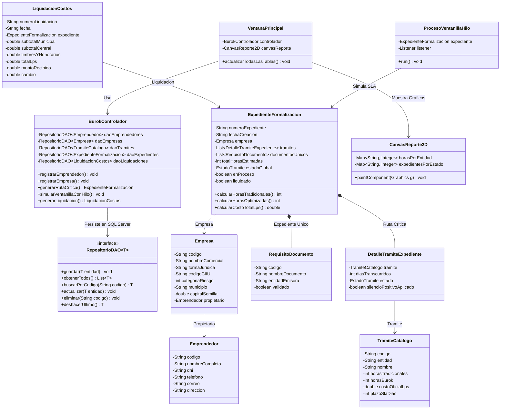
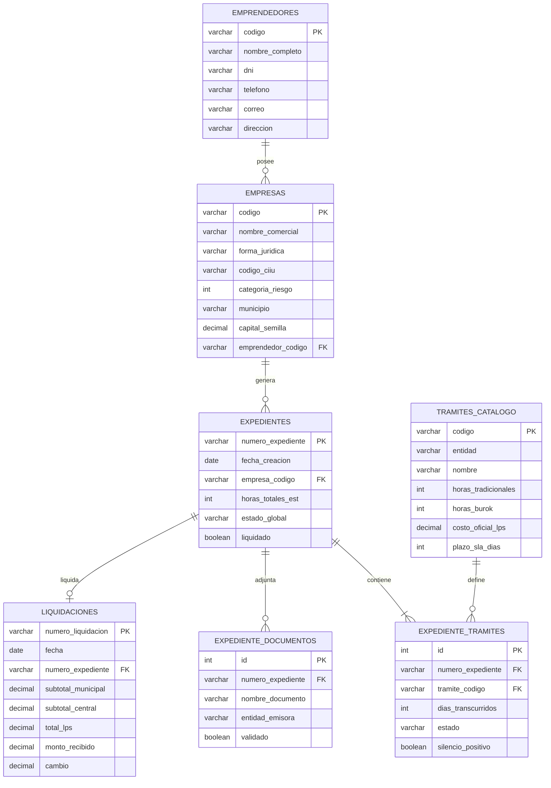

# Burok - Sistema de Gestión y Simulación de Formalización Empresarial (Honduras)

**Stack Tecnológico:** Java (Swing + JDBC) + Microsoft SQL Server  
**Patrón Arquitectónico:** Modelo-Vista-Controlador (MVC) + Capa DAO  
**Estado:** Versión 1.2.0 (Java 17 + SQL Server)

---

## 1. Descripción del Proyecto

**Burok** es una aplicación de escritorio desarrollada en **Java con interfaz gráfica Swing** y persistencia relacional en **SQL Server**, diseñada para diagnosticar, planificar, simular y gestionar el proceso de formalización de micro, pequeñas y medianas empresas (PyMEs) en Honduras.

El sistema ataca directamente la **paradoja burocrática de Honduras** (1,933 horas promedio de apertura frente a 242 horas anuales de operación), permitiendo a emprendedores, contadores y gestores:
* Clasificar empresas según su **código CIIU**, **nivel de riesgo** (Categoría 1–4) y **municipio**.
* Calcular automáticamente la **ruta crítica** de trámites ante **Notaría/IP, SAR, Alcaldía Municipal, MiAmbiente y ARSA**.
* Administrar un **Expediente Único Digital** sin duplicidad de documentos.
* Simular y monitorear en tiempo real mediante **multihilos** el avance de ventanillas y la aplicación del **Silencio Administrativo Positivo** (15 días hábiles para bajo riesgo).
* Liquidar costos oficiales en **Lempiras (L.)** y visualizar métricas de ahorro de tiempo en **gráficos Java 2D** sin librerías externas.

---

## 2. Arquitectura del Software (Patrón MVC + SQL Server DAO)

El proyecto se organiza en paquetes bajo el patrón MVC con persistencia **SQL Server** vía **JDBC**:

* **`main`**: Clase `Main.java` encargada de inicializar el Look & Feel (Nimbus), verificar la conexión a SQL Server y levantar la interfaz en el *Event Dispatch Thread* (EDT).
* **`conexion`**: Clase `ConexionSQLServer.java` encargada de gestionar la conexión JDBC hacia la base de datos `burok_db` en SQL Server.
* **`modelo`**: Clases del dominio del negocio en Honduras:
  * `Emprendedor.java` (Código, nombre/razón social, DNI/RTN, teléfono, correo, dirección).
  * `Empresa.java` (Código, nombre comercial, forma jurídica, código CIIU, categoría de riesgo, municipio, capital semilla, emprendedor propietario).
  * `TramiteCatalogo.java` (Código, entidad reguladora, nombre del trámite, horas promedio tradicionales, horas optimizadas Burok, costo oficial en Lempiras, plazo legal SLA en días).
  * `RequisitoDocumento.java` (Código, nombre del documento, entidad emisora, estado de validación, vigencia).
  * `EstadoTramite.java` (Enum: `PENDIENTE`, `EN_REVISION`, `SUBSANACION`, `SILENCIO_POSITIVO`, `APROBADO`, `RECHAZADO`).
  * `ExpedienteFormalizacion.java` (Número de expediente, fecha, empresa, lista de trámites asignados, lista de documentos del expediente único, avance porcentual, horas estimadas, estado global).
  * `DetalleTramiteExpediente.java` (Trámite asignado, ventanilla, días transcurridos, estado individual, costo aplicado).
  * `LiquidacionCostos.java` (Número de liquidación, expediente asociado, subtotal tasas municipales, subtotal licencias/SAR, honorarios/timbres, total en Lempiras, pago recibido, cambio/saldo).
* **`repositorio`** *(Capa DAO sobre SQL Server)*:
  * `RepositorioDAO<T>.java` (Interfaz genérica con operaciones CRUD + búsqueda indexada, respaldada por implementaciones JDBC SQL Server y una pila `Stack` en memoria para deshacer la última operación de captura en sesión).
* **`controlador`**:
  * `BurokControlador.java`: Orquesta los DAOs de SQL Server, las reglas de negocio (cálculo de ruta crítica por CIIU/municipio, validación de documentos únicos, liquidación en Lempiras) y la ejecución asíncrona de hilos.
* **`vista`**:
  * `VentanaPrincipal.java`: Ventana central con navegación por pestañas (`JTabbedPane`), tablas `JTable`, formularios, validaciones visuales, semáforos de SLA y barra de progreso.
  * `CanvasReporte2D.java`: Panel personalizado que hereda de `JPanel` y sobreescribe `paintComponent(Graphics g)` para dibujar manualmente gráficos de barras en `Graphics2D` (Comparativa Horas Tradicionales vs. Burok por Entidad, y Distribución de Expedientes por Estado).
* **`excepciones`**: Excepciones personalizadas del dominio:
  * `DocumentoFaltanteException.java`: Impide avanzar un trámite si falta un requisito obligatorio en el Expediente Único.
  * `EmpresaNoEncontradaException.java`: Disparada al buscar o asociar una empresa/emprendedor inexistente en SQL Server.
  * `PresupuestoInsuficienteException.java`: Rechaza liquidaciones o pagos inferiores al monto requerido de tasas oficiales.
* **`hilos`**:
  * `ProcesoVentanillaHilo.java`: Implementa `Runnable` para simular el flujo interinstitucional (IP -> SAR -> Alcaldía -> MiAmbiente/ARSA) y el conteo de días SLA / Silencio Administrativo Positivo (> 5 segundos de simulación), actualizando la interfaz vía `SwingUtilities.invokeLater` sin congelar el EDT y bloqueando ejecuciones duplicadas.

---

## 3. Diagramas de Diseño (UML y Base de Datos SQL Server)

### 3.1 Diagrama UML de Clases



### 3.2 Modelo Entidad-Relación (SQL Server `burok_db`)



---

## 4. Módulos, Pantallas y Funcionalidades

El sistema se organiza en **10 Módulos** integrados en una ventana principal con pestañas (`JTabbedPane`):

| Módulo | Pantalla / Pestaña Swing | Funcionalidades Clave |
| :--- | :--- | :--- |
| **1. Gestión de Emprendedores** | Tab 1: *Emprendedores* | CRUD completo en SQL Server, validación de DNI hondureño (13 dígitos) y campos obligatorios, prevención de códigos duplicados, botón Deshacer (`Stack`). |
| **2. Perfil de Empresas y CIIU** | Tab 2: *Empresas y CIIU* | Registro de empresa vinculada a emprendedor, selección de Forma Jurídica, Código CIIU, Municipio (Top 5 piloto) y Categoría de Riesgo (1–4). Filtrado por emprendedor. |
| **3. Catálogo Regulatorio Nacional** | Tab 3: *Catálogo de Trámites* | Catálogo precargado en SQL Server con los trámites de **IP/Notaría, SAR, Alcaldía, MiAmbiente y ARSA**, mostrando horas tradicionales (suma ~1,933 hrs), horas Burok (<120 hrs), tasas en Lempiras y plazo SLA legal. |
| **4. Expediente Único Digital** | Tab 4: *Expediente Único* | Repositorio de documentos maestros (DNI, Escritura, RTN, Contrato Local, Croquis). Evita cargar el mismo documento dos veces entre instituciones; alerta documentos faltantes o vencidos. |
| **5. Orquestador de Ruta Crítica** | Tab 5: *Expedientes y Ruta* | Genera la secuencia óptima de trámites según CIIU y municipio, calcula el ahorro en horas vs. el promedio nacional (1,933 hrs) y controla transiciones de estado. |
| **6. Liquidación de Tasas (L.)** | Tab 6: *Presupuesto y Liquidación* | Calcula subtotales por entidad (Municipal vs. Gobierno Central vs. Notarial), compara contra el capital semilla de la empresa y registra pagos/abonos con cálculo de cambio. |
| **7. Reportes Gráficos Java 2D** | Tab 7: *Analítica Java 2D* | Lienzo `Graphics2D` con 2 gráficos en tiempo real desde SQL Server: (1) Comparativa de Horas Tradicionales vs. Burok por Entidad, (2) Expedientes por Estado. |
| **8. Persistencia SQL Server + Genéricos** | Transversal (`repositorio`) | `RepositorioDAO<T>` conectado vía JDBC a SQL Server para persistencia real + `Stack` en memoria para función Deshacer (Undo). |
| **9. Excepciones Personalizadas** | Transversal (`excepciones`) | Captura de `DocumentoFaltanteException`, `EmpresaNoEncontradaException` y `PresupuestoInsuficienteException` con alertas `JOptionPane` sin cerrar el sistema. |
| **10. Simulador SLA Multihilo** | Integrado en Tab 5 | `ProcesoVentanillaHilo` (`Runnable`) simula en >5 seg el recorrido por las 4 ventanillas; si una entidad excede el SLA en Categoría 1, activa automáticamente **Silencio Administrativo Positivo**. |

---

## 5. Guía de Demostración Paso a Paso (Demo Flow)

1. **Paso 1 (Emprendedor):** Registrar al emprendedor `EMP-001` con su DNI y datos de contacto en SQL Server.
2. **Paso 2 (Empresa y CIIU):** Registrar la empresa `"Café Lempira S. de R.L."` (`PYM-001`), CIIU `5610` (Restaurantes/Cafeterías), Categoría de Riesgo `1 (Bajo)`, Municipio `Distrito Central`, Capital Semilla `L. 95,000.00`.
3. **Paso 3 (Catálogo Regulatorio):** Visualizar en la tabla los tiempos tradicionales (1,933 hrs acumuladas) vs. la meta optimizada Burok (<120 hrs).
4. **Paso 4 (Expediente Único):** Marcar y validar los documentos base una sola vez (DNI, Escritura, Contrato de Arrendamiento). Intentar procesar sin un documento obligatorio dispara `DocumentoFaltanteException`.
5. **Paso 5 (Ruta Crítica y Multihilo):** Generar el expediente `EXP-001` y presionar **"Simular Ventanilla y SLA (>= 5 seg)"**. La barra de progreso avanza por IP -> SAR -> Alcaldía -> ARSA/MiAmbiente; al detectar vencimiento de SLA en Categoría 1, aplica **Silencio Administrativo Positivo** y habilita el permiso provisorio.
6. **Paso 6 (Liquidación Financiera):** Seleccionar el expediente aprobado, visualizar el desglose de tasas en Lempiras y validar que un pago menor al total dispara `PresupuestoInsuficienteException`.
7. **Paso 7 (Reportes Java 2D):** Abrir la pestaña de Analítica para visualizar en tiempo real el impacto en horas ahorradas por institución y el estado de los expedientes en SQL Server.

---

## 6. Estructura del Proyecto

```text
Burok-TramiteFacilHN/
├── ANALISIS_ESTRATEGICO_BUROK_HONDURAS.md
├── CASOS_DE_USO_PASO_A_PASO.md
├── INFORME_PROYECTO_BUROK.md
├── MANUAL_DE_USUARIO_BUROK.docx
├── MANUAL_TECNICO_BUROK.docx
├── README.md
├── pom.xml
├── lib/
│   └── mssql-jdbc-12.8.1.jre11.jar
├── database/
│   └── schema_burok_sqlserver.sql
└── src/main/java/
    ├── main/Main.java
    ├── conexion/ConexionSQLServer.java
    ├── modelo/
    ├── repositorio/
    ├── controlador/BurokControlador.java
    ├── vista/
    │   ├── TemaBurok.java
    │   ├── VentanaPrincipal.java
    │   └── CanvasReporte2D.java
    ├── excepciones/
    └── hilos/ProcesoVentanillaHilo.java
```

---

## 7. Requisitos, Instalación y Ejecución

### Requisitos previos
* **Java Development Kit (JDK):** 17 LTS o superior (`java -version`).
* **SQL Server Server:** 8.0 o superior activo en el puerto `1433`.
* **Conector JDBC:** `lib/mssql-jdbc-12.8.1.jre11.jar` (ya incluido en el repositorio) o Maven mediante `pom.xml`.
* **IDE (opcional):** Apache NetBeans IDE 17+.

### Paso 1: Clonar el repositorio
```bash
git clone https://github.com/jomudev/Burok-TramiteFacilHN.git
cd Burok-TramiteFacilHN
```

### Paso 2: Crear la base de datos en SQL Server
Ejecuta el script `database/schema_burok_sqlserver.sql` para crear la base `burok_db`, sus 7 tablas y los datos iniciales de prueba:
```bash
sqlserver -u root < database/schema_burok_sqlserver.sql
```
*(Si tu usuario `root` tiene contraseña, usa `sqlserver -u root -p < database/schema_burok_sqlserver.sql` y actualiza `USER` / `PASSWORD` en `src/main/java/conexion/ConexionSQLServer.java` antes de compilar).*

### Paso 3: Compilar y ejecutar por terminal

**macOS / Linux:**
```bash
mkdir -p bin
javac -encoding UTF-8 -cp "lib/*" -d bin $(find src/main/java -name "*.java")
java -cp "bin:lib/*" main.Main
```

**Windows (PowerShell):**
```powershell
New-Item -ItemType Directory -Force -Path bin | Out-Null
$files = Get-ChildItem -Recurse -Filter *.java src\main\java | ForEach-Object { $_.FullName }
javac -encoding UTF-8 -cp "lib/*" -d bin $files
java -cp "bin;lib/*" main.Main
```

### Opción alternativa: Apache NetBeans IDE
1. Abrir **Apache NetBeans IDE**.
2. Ir a **File -> Open Project** y seleccionar la carpeta `Burok-TramiteFacilHN`.
3. Verificar que el servicio **SQL Server** esté corriendo en `localhost:1433`.
4. Presionar **Run Project** (`F6`).
